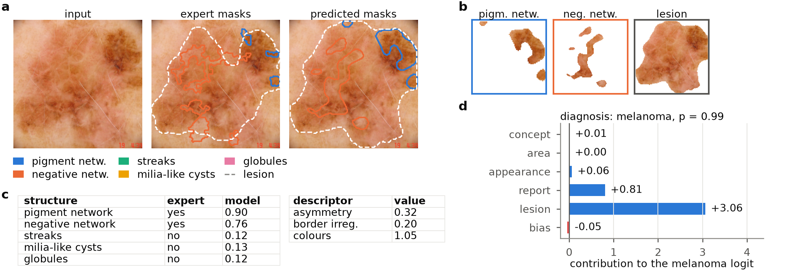
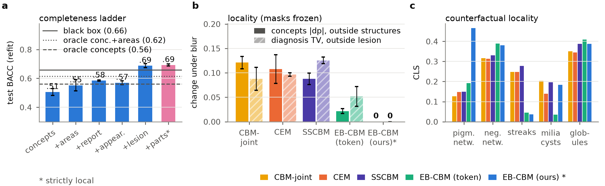
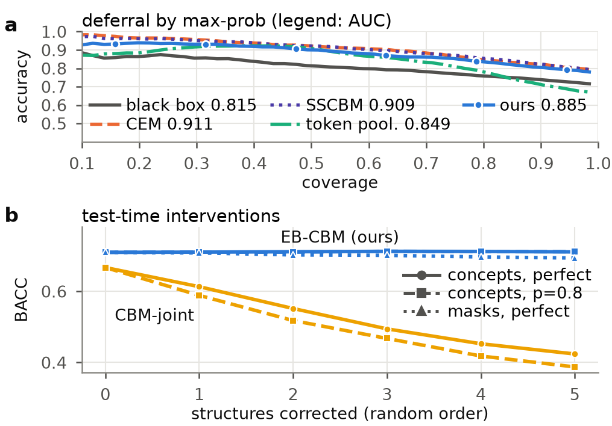

# EB-CBM: Evidence-Bound Concept Bottleneck Models

> **Evidence-Bound Concept Bottlenecks: Strictly Local, Auditable Concepts for Dermoscopic Diagnosis**
>
> Official code release of the paper: model, training, evaluation, data preparation and the scripts that produce
> the paper's figures and tables. The release contains **no** trained weights, **no** implementations of the
> baselines compared in the paper and **no** internal test scripts.



*Fig. 1: EB-CBM on a melanoma test image (ISIC_0036264). (a) Input, expert and predicted masks. (b) Evidence crops
(pixels outside each mask zeroed) and the masked lesion crop. (c) Concept probabilities versus expert labels; report
descriptors. (d) Contribution of each input group to the melanoma logit.*

---

## Contents

1. [Method](#1-method)
2. [Main results](#2-main-results)
3. [Repository layout](#3-repository-layout)
4. [Installation](#4-installation)
5. [Data preparation](#5-data-preparation)
6. [Counterfactual edits](#6-counterfactual-edits)
7. [Training](#7-training)
8. [Evaluation](#8-evaluation)
9. [Reproducing the paper figures and table](#9-reproducing-the-paper-figures-and-table)
10. [Configs and ablations](#10-configs-and-ablations)
11. [Notes and limitations](#11-notes-and-limitations)
12. [License, citation and acknowledgements](#12-license-citation-and-acknowledgements)

---

## 1. Method

Dermatologists justify a diagnosis by **naming** dermoscopic structures and by **pointing** at them. Concept
bottleneck models (CBMs) adopt the names, but every concept score is computed from the whole image, so nothing
guarantees that the score for "streaks" was read from the streaks. EB-CBM makes the explanation the evidence:

1. **Grounded structure localisation (expert-mask supervision).** A DINOv2 ViT-B/14 with registers (448 px input)
   feeds a light convolutional decoder that predicts soft masks (128 px) for the five dermoscopic structures
   (pigment network, negative network, streaks, milia-like cysts, globules) and the lesion, trained with BCE + soft
   Dice. The masks are binarised after a stop-gradient and are the **only** route from the full-image features to the
   decision.
2. **Evidence-bound concept scores.** For every binary mask the square bounding box (enlarged by 10 % per side) is
   resampled from the 512-px input to 224×224 with RoIAlign, every pixel outside the mask is zeroed and the mask is
   appended as a fourth channel. A shared ResNet-18 yields the presence logit `s_k` and a 4-d appearance descriptor
   `e_k` of each structure; masks covering less than 0.2 % of the image fall back to learned null values. For fixed
   masks, `∂(s_k, e_k)/∂F = 0` holds exactly (asserted on the first training batch) and no change outside a mask can
   change `s_k` or `e_k`.
3. **Report descriptors and a lesion descriptor.** Thirty ABCD-style report descriptors are computed
   deterministically from the (detached) masks: per structure the relative area, number of components, peripheral
   index and angular asymmetry; per lesion the asymmetry, border irregularity, area and the six ABCD colours. A 32-d
   lesion descriptor `z` is read by the same DINOv2 from the masked lesion crop (second forward pass). A linear
   diagnosis head reads only
   `φ = [σ(s_k), e_k, √a_k]_{k=1..5} ⊕ r ⊕ z ∈ R^92`,
   so every input is attributable to a region and all but `e_k` and `z` to a name. A *completeness ladder* (refitting
   the head on cumulative input groups) measures what each group adds.
4. **Counterfactual grounding (training loss).** For every training image and present structure c, LaMa inpaints the
   expert mask of c (`x^{-c}`, structure removed) and, as a paired control, an equal-area region inside the lesion that
   overlaps no structure (`x^{ctrl}`). On `x^{-c}` the targets of concept c and of its mask are switched off and all
   others kept; on `x^{ctrl}` all targets are kept and a KL term ties the predictions to those on the original image,
   so inpainting itself is no cue. On test edits, the counterfactual locality score CLS and the cross-effect XE audit
   any CBM.
5. **Interventions and deferral.** A concept intervention replaces `σ(s_k)` by the expert label; a spatial
   intervention replaces `M_k` by the expert mask and recomputes everything derived from it; low-confidence cases are
   deferred by the maximum class probability.

---

## 2. Main results

ISIC 2018 Task 1–2 official test set (n = 966), mean ± s.d. over three seeds. *Local*: every input of the diagnosis
head is computed inside a predicted mask. *Flip*: prediction flip rate under synthetic artefacts outside the lesion
(rulers, ink marks, dark corners, hairs). *PH2*: melanoma-versus-nevus AUROC of the frozen model on PH2. *Loc.TV*:
total-variation change of the diagnosis when pixels outside the predicted lesion are blurred with the masks frozen
(models without masks use the expert lesion mask).

| Method | Local | BACC | AUROC | cAUROC | Dice | Flip ↓ | PH2 | Loc.TV ↓ |
|---|:-:|---|---|---|---|---|---|---|
| Black box (DINOv2) | | .659 ± .006 | .861 ± .011 | – | – | .071 ± .004 | .913 ± .008 | .134 ± .022 |
| Token pooling (approx. local) | | .664 ± .017 | .828 ± .018 | .732 ± .053 | .252 ± .045 | .063 ± .008 | .903 ± .026 | .052 ± .020 |
| **EB-CBM (ours)** | ✓ | **.710 ± .030** | .885 ± .017 | .753 ± .006 | **.285 ± .007** | **.036 ± .003** | .931 ± .016 | **.000 ± .000** |
| &nbsp;&nbsp;w/o counterfactual grounding | ✓ | .672 ± .018 | .867 ± .018 | .723 ± .061 | .252 ± .058 | .036 ± .011 | .938 ± .014 | .000 ± .000 |
| &nbsp;&nbsp;+ discovered regions | ✓ | .695 ± .016 | .870 ± .012 | .748 ± .028 | .275 ± .026 | .039 ± .006 | .937 ± .010 | .000 ± .000 |

With the same backbone, split and class weighting, EB-CBM has a higher BACC than all nine CBM baselines compared in
the paper (best CBM baseline: SSCBM, .693 ± .015), ties the best AUROC (.885 vs .886), is the only strictly local
model and the only CBM whose concepts can be scored for grounding against the expert masks. The complete Table 1
including the baselines is in [`results/table1_main.csv`](results/table1_main.csv); every number quoted in the paper
(per-seed values, completeness ladder, random/shuffled-concept sanity checks, intervention curves, oracle ceilings)
is in [`results/final_numbers.json`](results/final_numbers.json).

<details>
<summary>Figures 2 and 3</summary>



*Fig. 2: (a) Completeness ladder of EB-CBM. (b) Change of concept probabilities outside the structures and of the
diagnosis outside the lesion under blur (masks frozen where available). (c) CLS per structure.*



*Fig. 3: (a) Deferral by maximum class probability. (b) BACC versus corrected structures: concept labels (perfect and
noisy expert) and expert masks.*

</details>

---

## 3. Repository layout

```
EB-CBM/
├── configs/
│   ├── base.yaml                 # defaults of every config (data, model, training, losses, counterfactual, eval)
│   ├── ebcbm.yaml                # flagship EB-CBM (Table 1 "EB-CBM (ours)")
│   └── ablations/                # ablations and reference models (Section 10)
├── src/cbm/
│   ├── paths.py                  # repository paths (overridable by environment variables)
│   ├── config.py                 # YAML configs: _base_ inheritance + --set command-line overrides
│   ├── track.py                  # file-based run registry (experiments/state, metrics.jsonl)
│   ├── datamod.py                # train/eval datasets: joint augmentation, soft mask targets, CF pairs, PH2 dataset
│   ├── data/
│   │   ├── registry.py           # dataset registry (classes, concepts, masks, splits)
│   │   ├── manifests.py          # builds manifest.csv and the 512-px image/mask caches
│   │   ├── datasets.py           # generic Dataset and JointTransform
│   │   ├── overlap.py            # perceptual-hash near-duplicate audit
│   │   └── report.py             # data statistics tables (markdown)
│   ├── models/
│   │   ├── backbone.py           # DINOv2 (Hugging Face) and ResNet-50-FPN (timm) backbones
│   │   ├── heads.py              # mask head, crop evidence, report descriptors, lesion descriptor, discovered parts, ...
│   │   └── ebc.py                # EBCModel: forward(x, concept_override, mask_override)
│   ├── train/
│   │   ├── trainer.py            # training loop, early stopping, prediction dumps, automatic evaluation
│   │   └── counterfactual.py     # LaMa counterfactual-edit preprocessing + counterfactual loss
│   ├── eval/
│   │   ├── evaluate_run.py       # evaluator: all metrics, interventions, locality, CF, artefacts, sanity, ladder, calibration
│   │   ├── metrics.py            # numpy metrics (task, ECE, concepts, grounding, leakage probe, OIS, deferral)
│   │   └── artefacts.py          # synthetic artefacts (ruler, ink, vignette, hair)
│   └── scripts/
│       ├── train.py              # training entry point
│       ├── queue.py              # multi-GPU job queue
│       ├── aggregate.py          # aggregates eval.json of many runs
│       └── make_figures.py       # paper Figs. 1-3, Table 1, final_numbers.json
├── scripts/
│   ├── download_isic2018.sh      # downloads and unpacks ISIC 2018 Task 1-2
│   ├── fetch_isic_metadata.py    # fetches diagnosis metadata from the ISIC Archive API (snapshot included)
│   └── download_lama.sh          # downloads the TorchScript big-lama checkpoint (counterfactual edits)
├── data/
│   ├── metadata/isic2018_task12/ # ISIC Archive metadata snapshot used in the paper (defines the 3-class labels)
│   └── splits/                   # validation hold-out ids used in the paper (311 training images)
├── experiments/jobs_paper.txt    # every training command behind the paper's own rows of Table 1 (3 seeds)
├── results/                      # paper Table 1 (csv) and all numbers (final_numbers.json)
├── docs/                         # data notes, evaluation notes, paper figures
├── requirements.txt / pyproject.toml / LICENSE / CITATION.cff
```

---

## 4. Installation

- Python 3.12 (paper environment) and an NVIDIA GPU with CUDA. The flagship peaks at about 12 GB of GPU memory at
  batch 32 with gradient checkpointing; the paper runs used an A100 40 GB.
- Core versions used for the paper: torch 2.11.0 (cu128), timm 1.0.30, transformers 5.19.0, numpy 2.5.2,
  Pillow 12.3.0, OpenCV 4.11.

```bash
git clone <this repository> EB-CBM && cd EB-CBM
python -m venv .venv && source .venv/bin/activate
# install torch / torchvision for your CUDA version from https://pytorch.org first, then:
pip install -r requirements.txt
pip install -e .            # editable install of the cbm package (alternatively: export PYTHONPATH=src)
```

The pretrained backbones are downloaded on first use: `facebook/dinov2-with-registers-base` from Hugging Face and
`resnet18.a1_in1k` from timm (set `HF_HOME` to choose the cache directory). Trained EB-CBM weights are not part of
this release.

All paths default to the repository root and can be overridden with environment variables: `CBM_ROOT` (repository
root), `CBM_DATA_ROOT` (data root, default `data/`), `CBM_LAMA_PT` (LaMa checkpoint, default
`models/big-lama.pt`). All commands below are run from the repository root.

---

## 5. Data preparation

See [docs/data.md](docs/data.md) for details.

### 5.1 ISIC 2018 Task 1–2 (main benchmark)

```bash
bash scripts/download_isic2018.sh      # ~12 GB: images, lesion masks, five attribute masks -> data/raw/isic2018_task12/
```

The three-class diagnosis (nevus / melanoma / seborrheic keratosis) comes from the `diagnosis_3` field of the public
ISIC Archive metadata: `Nevus → nevus`; `Melanoma in situ`, `Melanoma Invasive`, `Melanoma, NOS → melanoma`;
`Seborrheic keratosis → seborrheic_keratosis`; everything else (including missing values) is marked `other`
(label = −1) and excluded from training and evaluation by default (44 images: 4 train, 6 val, 34 test). The
repository ships the metadata snapshot used for the paper in `data/metadata/isic2018_task12/`; to fetch it again run
`python scripts/fetch_isic_metadata.py` (anonymous API, no token; the archive metadata may be revised over time).

### 5.2 PH2 (external test set)

The PH2 database (200 dermoscopic images, 40 melanomas) must be requested from the official site (ADDI project,
<https://www.fc.up.pt/addi/ph2%20database.html>). Place the unpacked content under `data/raw/ph2/` (any sub-layout;
the official `PH2_dataset.txt` table and the `IMDxxx` images must be present; the official `IMDxxx_lesion` masks are
cached as well). The paper used a public JPEG mirror of the same 200 images (without lesion masks); numbers obtained
from the official BMP files may differ marginally.

### 5.3 Building the manifests and the 512-px caches

```bash
python -m cbm.data.manifests isic2018_task12 ph2      # or "all"; --overwrite rebuilds the caches
python -m cbm.data.overlap                             # optional: near-duplicate audit -> data/processed/overlap_report.md
python -m cbm.data.report > data/processed/summary.md  # optional: data statistics tables
```

Each dataset is written to `data/processed/<dataset>/{manifest.csv, images_512/, masks_512/, build_stats.json,
per_image_stats.csv}`. ISIC 2018 Task 1–2 takes about 11 minutes with 60 worker processes. The manifests store
absolute paths; rebuild them after moving the data directory.

### 5.4 Split

Official split 2594 / 100 / 1000. For model selection and early stopping, a class-stratified 12 % of the official
training set (311 images; ids fixed in `data/splits/isic2018_task12_val_holdout_seed0.csv`, copied automatically to
`data/processed/isic2018_task12/` on first use) is merged with the official validation set, giving
**train 2279 / val 405 / test 966** (`other` images removed). The official test set is used for final evaluation only.

---

## 6. Counterfactual edits

The counterfactual grounding loss of the flagship (`configs/ebcbm.yaml`), and the CLS / XE metrics of the evaluator
for any model, require the precomputed LaMa inpaintings:

```bash
bash scripts/download_lama.sh                               # ~196 MB TorchScript big-lama -> models/big-lama.pt
CUDA_VISIBLE_DEVICES=0 python -m cbm.train.counterfactual --splits train val test [--batch 8]
```

For every labelled image and every present structure this produces `minus_<c>` (structure removed; expert mask
dilated by 3 px) and `ctrl_<c>` (an equal-area control region: a shape-matched shift of the mask, else a compact blob
inside the lesion, else the largest free region, else skin outside the lesion). Outputs go to
`data/processed/isic2018_task12/cf_512/` (images, region masks and `index.csv`, whose `post_<c>` columns give the
presence labels after each edit). The paper data yield 8546 edits (4273 pairs); about 10 minutes on one A100.

---

## 7. Training

```bash
# flagship, seed 0 (written to experiments/runs/ebcbm_s0/)
PYTORCH_CUDA_ALLOC_CONF=expandable_segments:True \
python src/cbm/scripts/train.py --config configs/ebcbm.yaml --run_id ebcbm_s0 --gpu 0

# any config value can be overridden on the command line (values are parsed as YAML)
python src/cbm/scripts/train.py --config configs/ebcbm.yaml --run_id ebcbm_s1 --set seed=1 train.batch_size=24

# all runs behind the paper's own rows of Table 1 (3 seeds), scheduled on several GPUs
python src/cbm/scripts/queue.py experiments/jobs_paper.txt --gpus 0,1
```

Training setup (`configs/base.yaml`): AdamW (learning rates 2e-5 backbone, 1e-4 local encoder, 2e-4 other heads,
1e-2 linear diagnosis head; weight decay 0.05), one epoch of linear warm-up followed by cosine decay, bf16 autocast,
gradient clipping 1.0, batch 32, class-weighted cross-entropy + concept BCE (`pos_weight = sqrt(neg/pos)`) + mask loss
(+ counterfactual terms); the flagship trains for up to 40 epochs with early stopping on validation BACC (patience
12). Training augmentation: random crops (area 0.7–1), flips, 90° rotations and mild colour jitter; evaluation uses
the resized whole image.

Every run writes `experiments/runs/<run_id>/`: `config.yaml` (fully resolved), `log.txt`, `metrics.jsonl` (train and
validation metrics per epoch), `best.pt`, `preds_{val,test,ph2}.npz` (prediction dumps, format in
docs/evaluation.md); the evaluation runs automatically afterwards and writes `eval.json` and `eval_summary.csv`. On
one A100 a flagship epoch takes about 80–190 s (depending on whether the GPU is shared); a run usually stops early
after 25–30 epochs, about 0.5–1.5 hours in total.

---

## 8. Evaluation

Evaluation runs automatically after training; an existing run can be re-evaluated, or only some tests recomputed:

```bash
python -m cbm.eval.evaluate_run --run_id ebcbm_s0 --gpu 0                      # all tests
python -m cbm.eval.evaluate_run --run_id ebcbm_s0 --tests sanity ladder --merge  # recompute and merge selected tests
python -m cbm.eval.evaluate_run --run_id ebcbm_s0 --tests calibration --merge    # dump-only, no GPU needed
python -m cbm.eval.evaluate_run --run_id ebcbm_s0 --fast                         # dump-based metrics only
```

What is evaluated (details in [docs/evaluation.md](docs/evaluation.md)):

| Group | Content |
|---|---|
| Task and concepts | ACC, BACC, macro-F1, AUROC (macro / melanoma), ECE, NLL; per-concept AUROC / F1 |
| Grounding | Dice / IoU of predicted vs expert masks, pointing accuracy, area MAE |
| Leakage | OIS, label-predictability probe from soft vs hard concept scores, Havasi test (ground-truth concepts fed to the head), heads refitted on random / shuffled inputs |
| Locality | change of concepts and diagnosis under blur / noise outside the structures vs inside each structure vs outside the lesion (including the strict fixed-mask variants) |
| Counterfactual | CLS, XE, diagnosis shift under structure removal, clinical direction checks |
| Robustness | flip rate, ΔBACC and concept drift under synthetic artefacts outside the lesion (ruler, ink, vignette, hair) |
| Interventions | concept interventions (random / uncertainty order; perfect and 80 %-correct noisy expert) and spatial interventions (predicted masks replaced by expert masks) |
| Deferral | accuracy–coverage AUC for max-probability / entropy deferral |
| Completeness ladder | test BACC of a linear head refitted on cumulative input groups (concepts → +areas → +report → +appearance → +lesion) |
| External validation | PH2 melanoma-vs-nevus AUROC / BACC, concept transfer AUROC |
| Calibration | test ECE / NLL after temperature scaling fitted on the validation set |

Each run also gets figures in `figures/<run_id>/`: mask overlays, counterfactual, intervention, deferral and artefact
examples.

---

## 9. Reproducing the paper figures and table

Once the runs of `experiments/jobs_paper.txt` have finished:

```bash
python src/cbm/scripts/make_figures.py --flagship ebcbm_s0 --show_variants
python src/cbm/scripts/aggregate.py --prefix ebcbm           # optional: aggregate eval.json by run-id prefix into a table
```

`make_figures.py` runs on the CPU, aggregates seeds from the runs' `eval.json` (run ids of the form
`<method>_s<seed>`) and writes `figures/paper/fig{1,2,3}*.{pdf,png}`, `results/table1_main.tex`,
`results/table1_main.csv` and `results/final_numbers.json`. The external baseline rows of the paper's Table 1 are not
part of this release; the script lists missing methods under `MISSING` at the end and skips them.

---

## 10. Configs and ablations

| Config | Table 1 row / purpose | Difference to the flagship |
|---|---|---|
| `configs/ebcbm.yaml` | EB-CBM (ours) | — |
| `configs/ablations/ebcbm_no_cf.yaml` | w/o counterfactual grounding | counterfactual loss disabled |
| `configs/ablations/ebcbm_discover.yaml` | + discovered regions | four extra unlabelled regions (inside the lesion, compact, non-overlapping); no counterfactual loss |
| `configs/ablations/token_pooling.yaml` | Token pooling (approx. local) | concept evidence by pooling DINOv2 tokens inside the predicted masks; no report or lesion descriptor |
| `configs/ablations/blackbox.yaml` | Black box (DINOv2) | linear classifier on mean-pooled features |
| `configs/ablations/ebcbm_hard.yaml` | hard-bottleneck variant mentioned in the text | appearance descriptors `e_k` removed |
| `configs/ablations/ebcbm_proto.yaml`, `ebcbm_proto_patch.yaml` | prototype variants mentioned in the text | lesion descriptor replaced by cosine similarities to 16 training-lesion prototypes (pooled / patch level) |

Key switches (all under `model:`): `concept_evidence.source: crop | tokens` (strictly local crop evidence vs
approximately local token pooling), `report_feats`, `lesion_embed.{enabled, dim, source}`, `discover.n_parts`,
`diag_head: soft_rr | hard | blackbox | ...`, `detach_masks`. `cf.{enabled, frac, max_pairs}` controls counterfactual
training (share of the batch carrying a pair and the cap on pairs per batch).

Model API (identical for every config): `out = model(x, concept_override=None, mask_override=None)` returns
`{"logits", "concept_logits", "masks", "extra"}`; `concept_override` (N, K) uses NaN for "no override",
`mask_override` (N, K+1, h, w) uses NaN planes for "no override". `extra["head_inputs"]` is the exact input matrix of
the diagnosis head and `model.head_input_names` names every column (`group:detail`).

---

## 11. Notes and limitations

- **Limitations of the study**: one modality with one external site, five expert structures, masks at 128 px, a
  lesion descriptor that is localised but not named, and a lower concept AUROC than whole-image predictors because
  structures are detected from their own crops.
- **Baselines**: the nine CBM baselines of the paper (CBM-joint, CEM, PCBM-h, LF-CBM, LaBo, Explicd, SSCBM, a
  multi-task segmentation-and-classification network, ...) are not implemented in this release (some depend on
  third-party official code); only their numbers under the shared protocol are provided (`results/table1_main.csv`).
- **Randomness**: bf16 and cuDNN non-determinism make single-seed BACC fluctuate by about ±0.03 (the test set has
  only 76 seborrheic keratosis images); always report the mean and s.d. over three seeds.
- **Data**: ISIC 2018 Task 1–2 contains 18 near-duplicate test–train image pairs with different ids (the paper keeps
  the official split for comparability with prior work; see `docs/data.md`); attribute masks may extend beyond the
  lesion mask, so `<c>_area` is clipped at 1; the prevalence of milia-like cysts differs between training (26 %) and
  validation/test (6–9 %).
- **GPU memory**: reduce `train.batch_size` or `cf.max_pairs` if memory is short, and keep
  `model.backbone.grad_checkpointing: true` (the default).
- **External services**: the code needs no online service; the network is used only to download the pretrained
  backbones and the ISIC data.

---

## 12. License, citation and acknowledgements

The code is released under the [MIT License](LICENSE). The datasets keep their own terms: ISIC 2018 challenge data
(<https://challenge.isic-archive.com/data/>) and the PH2 database (ADDI project). Pretrained models: DINOv2 (Meta AI,
Apache-2.0), the timm ResNet-18 (Apache-2.0) and the LaMa inpainting model (Samsung AI, Apache-2.0; TorchScript export
from simple-lama-inpainting).

If this code is useful for your research, please cite the paper (author details will be added after the review
period, see [CITATION.cff](CITATION.cff)):

```bibtex
@article{ebcbm2026,
  title   = {Evidence-Bound Concept Bottlenecks: Strictly Local, Auditable Concepts for Dermoscopic Diagnosis},
  author  = {TODO},
  journal = {TODO},
  year    = {2026}
}
```
